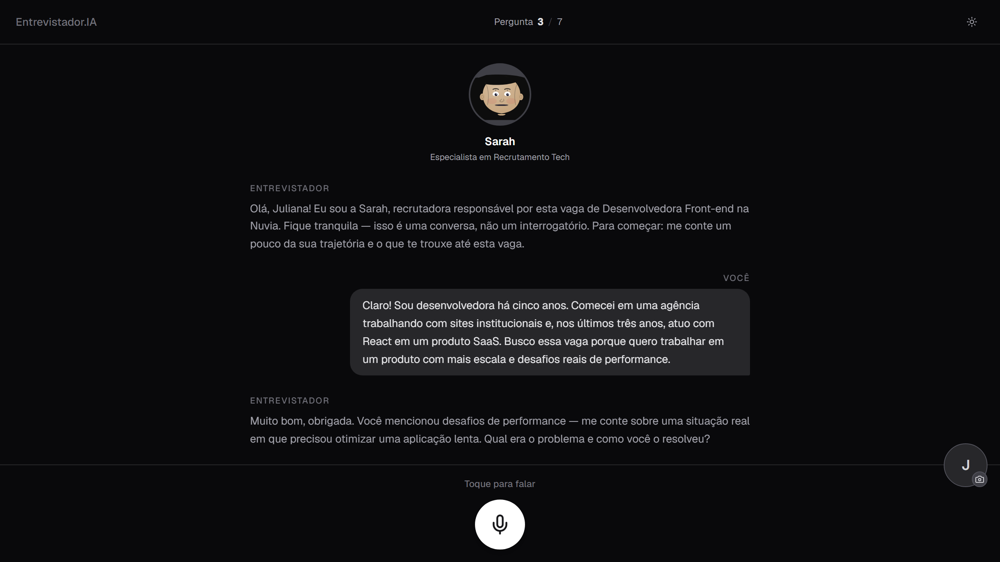
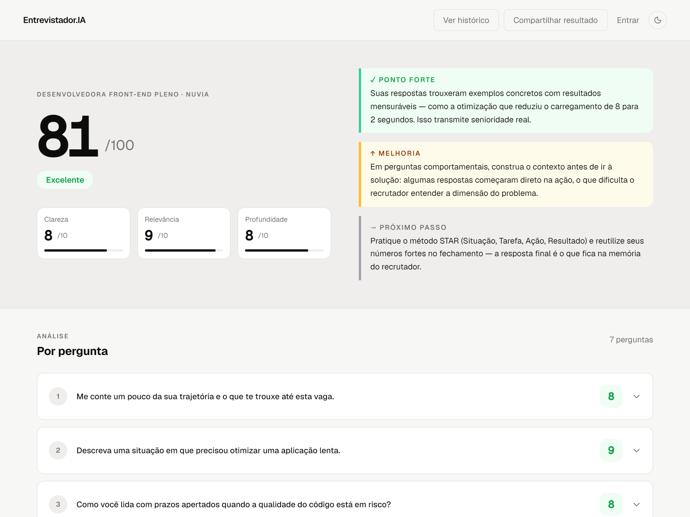
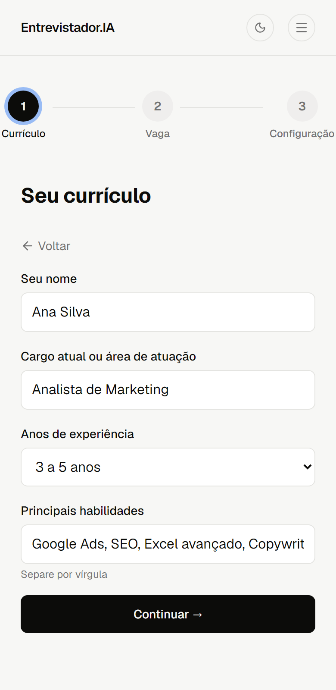

# Entrevistador.IA: AI Mock Interview Platform


**Entrevistador.IA** lets job seekers practice realistic, voice-based job interviews with an AI recruiter. The candidate uploads a resume and a job posting; the AI interviewer asks questions tailored to both, listens to spoken answers, and finishes with a scored report and concrete feedback.

🌐 Live: [entrevistador-ai.com.br](https://entrevistador-ai.com.br) · 🇧🇷 Built for the Brazilian market (UI in Portuguese, interviews in Portuguese or English)

---

## Screenshots

| Interview | Feedback report |
|---|---|
|  |  |

| Resume step (mobile) | Interview (mobile) |
|---|---|
|  |  |

---

## How it works

1. **Resume:** upload a PDF/DOCX (or fill in a short form). Text is extracted server-side; scanned PDFs fall back to page images read by a vision model.
2. **Job:** paste a job posting, or let the AI generate a realistic one from a job title.
3. **Setup:** choose the interviewer persona, language (pt-BR / en-US), and number of questions.
4. **Interview:** the AI asks one question at a time, adapting follow-ups to previous answers. Questions are spoken aloud (text-to-speech) and the candidate answers by voice (browser speech recognition) or text.
5. **Report:** an overall score (0–100), per-question scores, clarity / relevance / depth ratings, competency scores, and a written strength, improvement area, and next step.

## Features

- Voice interview with three interviewer personas and natural-sounding TTS
- Resume and job-posting parsing into structured JSON with LLMs
- Per-turn answer evaluation and a final feedback report
- Interview history and shareable results
- Accounts with email or Google sign-in
- Payments with Mercado Pago (card, Pix, and subscriptions) and a credit system
- Responsive UI with light/dark mode

## Tech stack

| Layer | Technology |
|---|---|
| Front end | Next.js 14 (App Router), React 18, TypeScript, Tailwind CSS, shadcn/ui, Zustand |
| Back end | Next.js API routes (Node.js), deployed on Vercel |
| Database & auth | Supabase (PostgreSQL, Auth with Google OAuth, Row Level Security) |
| AI | Anthropic Claude or OpenRouter (Gemini / Claude) for parsing, interviewing, and feedback; OpenAI for text-to-speech |
| Documents | pdf-parse, pdf.js, @napi-rs/canvas, mammoth (DOCX) |
| Payments | Mercado Pago (Checkout, Pix, subscriptions, webhooks) |
| Infra | Upstash Redis (rate limiting, cost cap), Sentry (error monitoring), Telegram (ops alerts) |

## Architecture & engineering decisions

**Provider-agnostic AI layer** (`src/lib/services/claude.ts`)
A single service chooses the provider from the environment (Anthropic direct or OpenRouter) and maps each task to a model sized for it: a cheap, fast model for structured extraction, a low-latency model for live interview turns, and a stronger model for the final report.

**Security**
- **Row Level Security** on every Supabase table (`db/rls-policies.sql`): users can only read their own rows; all writes go through server routes using the service role.
- **Webhook signature verification:** Mercado Pago webhooks are validated with HMAC-SHA256 before any credit or subscription is granted.
- **Security headers:** strict Content-Security-Policy, HSTS, `X-Frame-Options: DENY`, and a restrictive Permissions-Policy (`next.config.js`).
- Server-side auth checks on every user-data route, input validation, and request-size limits on uploads.
- No secrets in the repository: all keys come from environment variables.

**Abuse and cost protection**
- **Rate limiting** per IP with Upstash sliding windows, tuned per route type (AI calls, parsing, light queries, sessions per day).
- **Daily cost circuit breaker** (`src/lib/services/cost-cap.ts`): estimated AI spend from anonymous traffic is tracked in Redis; once a daily cap is reached, free usage pauses while paying users are unaffected. This protects against abuse that rotates IPs.

**Reliability**
- Sentry on client, server, and edge runtimes.
- Long-running AI routes use explicit timeouts (`maxDuration`) and graceful fallbacks when parsing fails.

## Project structure

```
src/
  app/              # Pages (App Router) and API routes
    api/
      interview/    # turn-by-turn interview + final feedback
      parse-resume/ # resume extraction (text + vision fallback)
      parse-job/    # job posting extraction
      tts/          # text-to-speech
      mp-*/         # Mercado Pago checkout, Pix, subscriptions, webhooks
      session/      # save, history, results
  components/       # UI: setup, interview, payment, auth
  hooks/            # voice input and other client hooks
  lib/services/     # AI client, rate limit, cost cap, auth, Supabase
db/                 # SQL: RLS policies, subscriptions
```

## Running locally

```bash
git clone https://github.com/JoaoAntonioCarvalho/entrevistador-ai.git
cd entrevistador-ai
npm install
cp .env.example .env.local   # then fill in your keys
npm run dev
```

Open http://localhost:3000.

### Environment variables

| Variable | Purpose |
|---|---|
| `ANTHROPIC_API_KEY` **or** `OPENROUTER_API_KEY` | LLM provider (configure exactly one) |
| `OPENAI_API_KEY` | Text-to-speech |
| `NEXT_PUBLIC_SUPABASE_URL`, `NEXT_PUBLIC_SUPABASE_ANON_KEY`, `SUPABASE_SERVICE_ROLE_KEY` | Database and auth |
| `UPSTASH_REDIS_REST_URL`, `UPSTASH_REDIS_REST_TOKEN` | Rate limiting and cost cap |
| `DAILY_COST_CAP_USD` | Daily spend cap for anonymous traffic (default 10) |
| `MP_MODO`, `MP_ACCESS_TOKEN_*`, `MP_PUBLIC_KEY_*`, `MP_WEBHOOK_SECRET_*` | Mercado Pago (test/prod) |
| `NEXT_PUBLIC_APP_URL` | Public site URL |
| `NEXT_PUBLIC_SENTRY_DSN` | Error monitoring (optional) |
| `TELEGRAM_BOT_TOKEN`, `TELEGRAM_CHAT_ID` | Ops alerts (optional) |

**Database:** Supabase Postgres with the tables `sessions`, `credits`, `payment_sessions`, `subscriptions`, and `audit_log`. Row Level Security policies live in `db/rls-policies.sql`; the subscriptions table in `db/subscriptions.sql`.

## Roadmap

- Upgrade to Next.js 15
- Version the full database schema as Supabase migrations
- Automated end-to-end tests with Playwright
- Interviewer personas for more roles and seniority levels

## Author

Designed and built by **João Carvalho**, Computer Engineering student at Faulkner University.
[LinkedIn](https://www.linkedin.com/in/joao-antonio-de-moraes-carvalho-06a194270) · [GitHub](https://github.com/JoaoAntonioCarvalho)
